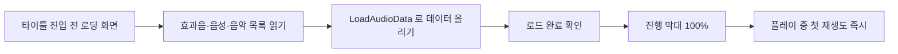
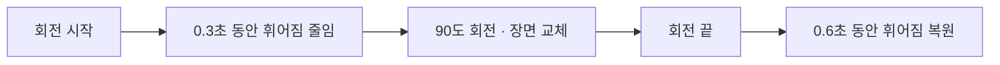
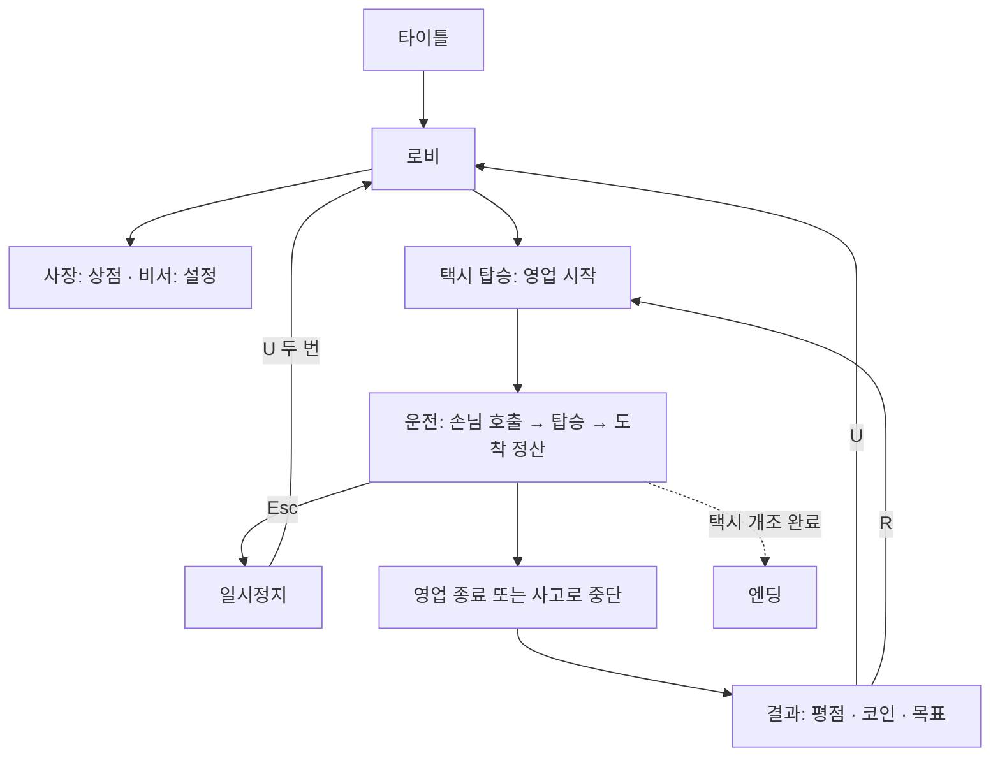
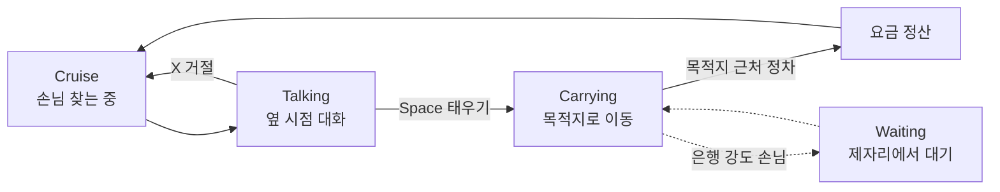
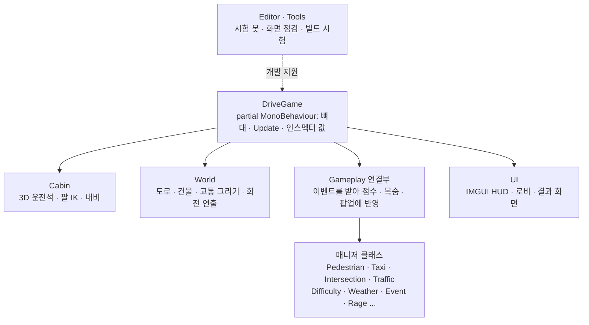
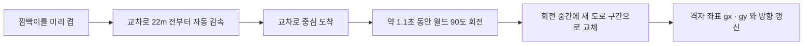
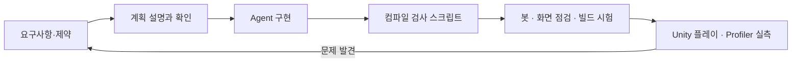

<div align="center">

# DON'T HIT ME

운전석 1인칭 시점으로 둥글게 휜 도시 도로를 달리며  
손님을 태우고, 길을 건너는 무단횡단자를 조향으로 피하는  
**PC 아케이드 택시 게임**

<p>
  
  
  
  
</p>

</div>

<!-- itch.io 페이지와 시연 영상이 생기면 주석을 풀고 링크를 넣으세요.
<p align="center">
  <a href="https://아이디.itch.io/게임주소">
    
  </a>
  &nbsp;
  <a href="YouTube_링크">
    
  </a>
</p>
-->

---

## 프로젝트 소개

**Don't Hit Me**는 차를 제자리에 두고 월드가 다가오는 1인칭 택시 게임입니다. 도로는 앞쪽으로 갈수록 아래로 휘어지고(동물의 숲 같은 원통형 맵), 플레이어는 조향으로 도로를 건너는 사람과 다른 차를 피하며 손님을 목적지까지 데려다줍니다.

하루 영업이 끝나면 요금에서 사고 수리비를 뺀 결과로 평점을 받고, 번 코인으로 업그레이드와 택시 개조를 하며 엔딩까지 진행합니다.

게임플레이 구현에 그치지 않고 다음을 하나의 게임으로 연결했습니다.

- 휘어진 도로 위에서 90도 회전하는 교차로와 격자 좌표 기반 도시
- 손님 호출 → 대화 → 탑승 → 도착 정산 흐름과 손님 유형별 사건
- 2D 횡스크롤 로비, 상점, 4단계 택시 개조, 엔딩
- 괴수·히어로·좀비의 날 같은 사건과 랜덤 인카운트, 분노 게이지
- 영어·한국어 전환과 조작 키 설정
- 자동 플레이 봇, 화면 점검, 빌드 시험 도구와 Profiler 기반 성능 최적화

<!--
<p align="center">
  
</p>
-->

---

## 개발 정보

| 항목 | 내용 |
|---|---|
| 엔진 | Unity 6000.3.5f2 / URP 17.3.0 |
| 언어 | C# (스크립트 69개, 약 1.5만 줄) |
| 입력 | 새 Input System 1.17.0 |
| 플랫폼 | PC (Windows), 16:9 기준 |
| 개발 형태 | 개인 포트폴리오 프로젝트 / 1인 개발 |
| 개발 기간 | 2026.10 (저장소 첫 커밋 2026.10.13) |
| 상태 | 안정화와 밸런스 단계 |
| 배포 | itch.io 등록 예정 |
| 사용한 외부 에셋 | Kenney City Kit (CC0, 저장소 포함), 그 외 유료 에셋은 저장소에 포함하지 않음 |

---

## 최근 작업

성능과 완성도를 측정으로 확인하며 다듬었습니다. 수치는 모두 Unity 에디터에서 2560x1440으로 잰 값입니다.

| 문제 | 적용한 변경 | 확인 기준 |
|---|---|---|
| 게임 시작 직후 한 프레임이 680ms | 로딩 화면에서 소리·음악을 미리 읽음 | Profiler 프레임 680ms → 26.5ms |
| 비 오는 날 사람을 칠 때 41.9ms 프레임 | 소리 파일 데이터를 로딩 중 메모리에 미리 올림 | 효과음 첫 재생 최대 46.8ms → 0.3ms |
| 로비가 보이지 않는 3D 월드까지 그림 | 로비·상점·엔딩에서 3D 월드 렌더링 끔 | 로비 Tris 146.2k → 1.6k, Batches 1622 → 526 |
| 머티리얼 1145개 | 길가 소품 재질 공유 | 머티리얼 약 214개 |
| 교차로 회전 중 먼 건물이 크게 기울어 보임 | 회전하는 동안 휘어짐을 줄였다 되돌림 | 회전 장면 연속 사진 비교 |
| 빌드에서 셰이더가 빠질 위험 | URP Lit/Unlit을 Always Included에 추가 | 개발 빌드 화면 점검, 분홍색 없음 |
| 영어 모드에서 글자가 상자를 넘침 | 화면 점검 도구로 전 화면 자동 검사 | 영어·한국어 모두 넘침 0건 |

---

## 핵심 문제 해결 1: 소리 파일 첫 재생 때 생기는 렉

### 문제

Profiler로 보니 두 가지 렉이 같은 원인이었습니다.

| 장면 | Profiler에서 본 것 |
|---|---|
| 게임 시작 직후 | 한 프레임 680ms. `DriveGame.LateUpdate` 655.6ms 중 `SoundManager` 271.8ms, `Loading.ReadObject` 241.9ms |
| 비 오는 날 + 연속 충돌 | 프레임 41.9ms. `UpdateScene` 33.5ms → `SoundManager.LoadFMODSound` 32.0ms → `File.Open` 30.0ms |

처음에는 GC나 글자(IMGUI) 생성을 의심했지만, 비 장면의 GC 할당은 1KB, OnGUI는 2ms뿐이라 원인이 아니었습니다. 처음 나는 소리(피, 비명 등)의 파일을 그 자리에서 디스크에서 읽고 있었습니다.

게다가 소리 파일 91개가 모두 `Preload Audio Data` 꺼짐이라, `Resources`로 불러와도 **소리 데이터는 첫 재생 때** 읽혔습니다. 로딩 화면에서 `Resources.LoadAll`만 하는 첫 수정으로는 부족했습니다.

### 개선

```csharp
// 이전: 목록만 만들고 끝 → 데이터는 첫 재생 때 디스크에서 읽힘
foreach (var c in Resources.LoadAll<AudioClip>("Audio/sfx")) bank.Add(c);

// 개선: 로딩 중에 데이터까지 올리고, 올라올 때까지 기다림
pending[j].LoadAudioData();
while (pending[j].loadState == AudioDataLoadState.Loading) yield return null;
```



| 항목 | Before | After |
|---|---:|---:|
| 효과음 91개 첫 재생 최대 | 46.8ms | 0.3ms |
| 효과음 91개 첫 재생 합계 | 527ms | 1ms |
| 비 + 연속 충돌 프레임 | 41.9ms | 11.3ms |
| 첫 렉 프레임 | 680ms | 26.5ms |

- "소리 데이터를 내린 상태"와 "미리 읽은 상태"를 같은 코드로 비교해 효과를 수치로 확인했습니다.
- 대가: 로딩 화면이 약 0.8초에서 2.5초로 늘었고(빌드에서는 약 3.9초), 소리 데이터가 메모리에 올라가는 만큼 메모리 사용량이 늘어납니다. 메모리 증가량은 측정하지 않았습니다.

---

## 핵심 문제 해결 2: 교차로 회전 때 기울어지는 건물

### 문제

교차로에서 월드가 90도 도는 약 1초 동안 먼 건물이 크게 기울고, 새 도로가 위로 솟아 보였습니다.

### 원인 확인

회전 장면을 2프레임마다 찍는 도구를 만들어 연속 사진으로 직접 확인했고, 휘어짐 값을 거의 0으로 한 채 같은 회전을 찍어 비교했습니다. 휘어짐이 없으면 회전이 깔끔했으므로, **휘어진 면 위에서 도로가 옆으로 도는 것**이 원인으로 확정됐습니다.

### 개선

```csharp
float curvK = 1f;                                  // 1 = 평소, 0 = 평평
float Curv => curvature * curvK;
float Drop(float z) => -Curv * z * z;

// 회전하는 동안만 휘어짐을 줄이고, 끝나면 천천히 되돌린다
curvK = Mathf.MoveTowards(curvK, turning ? 0f : 1f, Time.unscaledDeltaTime / flatTime);
```



- 도로, 건물, 소품, 보행자, 차가 모두 같은 `Drop()`/`Curv`를 쓰도록 해서 한 값만 바꿔도 모두 일관되게 움직입니다.
- 줄이고 되돌리는 시간은 인스펙터의 `turnFlattenIn` / `turnFlattenOut`으로 조절합니다.
- 한계: 회전 중에 지평선이 잠깐 평평해집니다.

---

## 플레이 흐름



### 손님 한 명의 흐름



---

## 조작

| 키 | 동작 |
|---|---|
| A / D, ← / → | 조향 |
| S / ↓ | 브레이크 |
| Q / E | 좌 / 우 깜빡이 |
| Space | 손님 태우기 (로비에서는 대화 넘기기와 택시 타기) |
| X | 손님 거절 |
| Esc / P | 일시정지 (일시정지 중 U를 두 번 누르면 정산하고 로비로) |
| R | 다시 시작 |
| U | 게임 오버 화면에서 로비로 |
| O | 설정 (타이틀 / 로비 / 일시정지) |

조향, 브레이크, 깜빡이, 태우기, 거절 키는 설정의 "조작 키 설정"에서 바꿀 수 있습니다. 시작은 타이틀 화면에서 Space 또는 Enter입니다.

---

## 클라이언트 구조



- **DriveGame**: 씬에 붙는 MonoBehaviour는 하나이고, 역할별 파일로 나눈 `partial class`입니다. 튜닝 값은 모두 public 필드로 노출해 인스펙터에서 조절합니다.
- **매니저**: 일반 C# 클래스입니다. 설정은 `DriveGame`의 public 필드를 읽고, 게임 결과(점수·목숨·팝업)는 이벤트로 알리며, 차 상태(속도·위치)는 `Tick` 인자로 받습니다.
- **연결부**: `DriveGame.*.cs`가 매니저 이벤트를 받아 화면, 소리, 점수에 반영합니다.

---

## 주요 구현

### 1. 원통형 도로

차는 제자리에 있고 도로 구간(4m 단위)이 다가옵니다. 구간 높이를 `y = -curvature * z²`로 낮추고 기울여서 앞쪽으로 휘어 내려가는 지평선을 만듭니다. 사람과 차는 같은 `Drop()`으로 높이를 맞춘 2D 스프라이트 빌보드입니다.

### 2. 교차로 회전과 도시 좌표



- 80m마다 교차로가 있고, 진입 전에는 절대 돌지 않습니다.
- 도시는 격자 좌표와 방향(heading)으로 추적하고, 건물 해시를 월드 좌표 기준으로 정해서 **같은 길은 어느 방향으로 지나도 같은 건물**이 보입니다.

### 3. 3D 팔 IK

어깨-팔꿈치-손목 2본 IK로 팔을 핸들에 올리고, 손가락은 핸들 접선축을 기준으로 굽혀 쥡니다. 분노 게이지가 차오르면 손 색이 붉어집니다.

### 4. 로우폴리 3D 도시

Kenney City Kit(CC0)의 건물 모델 19개를 세 구간(12m)마다 한 채씩 세우고(풀링), 가로등·소화전 같은 길가 소품은 코드로 만든 3D 도형입니다.

### 5. 밤 조명

차 양쪽의 실제 스포트라이트가 앞쪽에서 모이고 도로만 비춥니다. 빛을 못 받는 2D 스프라이트(사람, 차)는 같은 원뿔과 거리 감쇠 계산으로 색을 어둡게 칠합니다. 정전 사건도 같은 조명을 씁니다.

### 6. 손님 유형별 사건

| 유형 | 사건 |
|---|---|
| 폭탄 | 속도가 낮으면 도화선이 타서 폭발, 끝까지 가면 요금 2배 |
| 결혼식 | 급조향·급제동하면 부케가 앞유리에 붙고 행복도 하락 |
| 외계인 | 내비에 목적지가 안 보이고 UFO 빛줄기 기둥을 찾아 멈춤 |
| 전직 레이서 | 시간이 짧고 평균 속도가 빠를수록 요금이 오름 |
| 욱하는 손님 | 갑자기 핸들을 잡힘, A/D 연타 게이지를 양쪽으로 채워야 풀림 |
| 은행 강도 | 은행에서 대기한 뒤 경찰을 피해 도망 |

### 7. 다국어와 키 설정

- 코드 안의 글은 `Loc.T("한국어", "English")`, 대사·이름 표는 `"한국어‖English"` 한 줄로 적고 읽을 때 `Loc.S()`로 분리합니다.
- 조작 키는 `Keybinds`가 `PlayerPrefs`에 저장하고, 안내 글(튜토리얼, 하단 키 안내)이 바꾼 키를 따라갑니다.

### 8. 자동 시험 도구

Unity를 배치 모드로 돌려 사람이 못 보는 문제를 찾습니다.

| 도구 | 하는 일 |
|---|---|
| 시험 봇 (`Tools/run-simbot.ps1`) | 가상 키보드로 운전해 며칠치 영업을 돌리고 오류, 사고 원인, 수입, 프레임 시간, 메모리를 보고서로 남김. 설정을 바꿔 가며 밸런스를 비교(`sweep-simbot.ps1`) |
| 화면 점검 (`Tools/run-uishots.ps1`) | 전 화면을 영어·한국어로 만들어 글자가 상자를 넘는지, 영어 모드에 한국어가 남았는지 검사하고 스크린샷 저장 |
| 빌드 시험 (`Tools/run-build-test.ps1`) | 개발 빌드를 저장소 밖에 만들어 그 exe로 화면 점검을 돌려 분홍색 셰이더나 빠진 파일을 확인 |
| 회전 연속 사진 (`-TurnShots`) | 교차로 회전 장면을 2프레임마다 저장 |

봇으로 난이도를 조정한 예: 사고율 2.17회/분 → 약 1.3회/분 (동시에 건너는 사람 수, 건너는 속도, 체력 회복 시간 등을 조정). 봇은 사람이 아니므로 절대 난이도가 아니라 설정 간 상대 비교에만 씁니다.

---

## AI Agent 활용과 검증

개발 전반에 **Claude Code**를 코드 작성, 측정 도구 제작, 원인 분석에 사용했습니다. 기획과 방향 결정, 플레이 테스트, Profiler·Stats 캡처와 최종 확인은 직접 했습니다.



`CLAUDE.md`에 작업 규칙을 명시했습니다.

- 코드를 쓰기 전에 계획을 설명하고 확인받기
- 확인하지 않은 것을 확인했다고 말하지 않기 (Unity 에디터를 직접 못 돌리므로 플레이 결과는 사용자가 확인)
- 코드를 바꾼 뒤 컴파일 검사(`check-compile.ps1`)에서 "컴파일 OK"가 나온 것만 커밋하기
- 삭제, 푸시처럼 되돌리기 어려운 작업은 실행 전에 확인받기
- 구매한 에셋은 `Assets/_External/`에만 두고 절대 커밋하지 않기, 푸시 전에 금지 파일 검사

점검용 서브에이전트(`qa-tester`, `design-reviewer`, `ui-designer`)를 따로 두어 구현 후 정적 점검과 설계 검토를 맡겼습니다. 한 예로, 최적화 과정에서 만든 버그(로비에서 돌아오면 월드가 안 보임)와 점검 도구 자체의 문제(배치 모드에 키보드가 없어 월드가 배치되지 않음)를 자동 스크린샷과 진단 로그로 구분해 찾았습니다.

---

## 저장 데이터

- 최고 점수, 코인, 업그레이드, 오늘의 목표, 날짜(Day), 언어, 조작 키, 튜토리얼과 엔딩 진행은 `PlayerPrefs`에 저장합니다.
- 시험 도구(봇, 화면 점검, 빌드 시험)는 실행 전에 `PlayerPrefs`(레지스트리)를 백업하고 실행 후 복구해서 실제 저장 데이터를 건드리지 않습니다.

---

## 프로젝트 구조

```text
Assets/
├─ Game/
│  ├─ Scenes/DriveScene.unity    # 씬 (컴포넌트 하나로 월드가 코드로 생성됨)
│  ├─ Resources/CityKit/         # Kenney City Kit 3D 건물 (CC0)
│  └─ Scripts/
│     ├─ DriveGame.cs            # 뼈대 (인스펙터 값, Update, ResetGame)
│     ├─ Cabin/                  # 3D 운전석 · 팔 IK · 내비 · 뉴스 · 미니건
│     ├─ World/                  # 도로·건물·교통 그리기 · 회전 연출 · 픽셀 아트 로드
│     ├─ Gameplay/               # 매니저 클래스 + 연결부 (보행자 · 택시 · 교차로 · 교통 · 사건 ...)
│     ├─ UI/                     # IMGUI HUD · 로비 · 상점 · 결과 화면 · 점검 도구
│     └─ Editor/                 # 씬 생성 · 시험 봇 실행 · 빌드 시험
├─ Settings/                     # URP 설정
Tools/                           # 시험 봇 · 화면 점검 · 빌드 시험 · 픽셀 아틀라스 스크립트
.claude/agents/                  # 점검용 서브에이전트 지시문
```

---

## 실행 방법

1. Unity 6 (6000.3.5f2)로 프로젝트를 엽니다. URP, 새 Input System을 사용합니다.
2. 아래 **에셋** 항목의 파일을 `Assets/_External/`에 넣습니다. (없어도 도형과 코드로 만든 소리로 대체되어 실행은 됩니다)
3. 픽셀 아트 팩을 넣었다면 `python Tools/build-pixel-atlas.py`로 한 장의 아틀라스를 만듭니다.
4. `Assets/Game/Scenes/DriveScene.unity`를 열고 Play를 누릅니다.

씬을 새로 만들려면 메뉴 `Game → Create Drive Scene`을 사용합니다.

---

## 에셋

- **Kenney City Kit (Commercial)** — CC0 라이선스라서 저장소에 포함되어 있습니다 (`Assets/Game/Resources/CityKit/`). 만든 사람: [Kenney](https://www.kenney.nl) (크레딧 표기 권장, 필수 아님).
- 아래는 라이선스상 **재배포가 금지되어 저장소에 포함하지 않았습니다.** `Assets/_External/`에 넣으면 쓰이고, 없으면 도형 그림이나 코드로 합성한 소리로 대체됩니다.
  - 픽셀 아트 ([GandalfHardcore](https://gandalfhardcore.itch.io/)): City Tiles, Modern NPCs, Zombies, Modern Pixel Art Enemies (외계인/UFO), Farm Animals, Hell Asset Pack
  - 음악: Racing Neo Electronica 002
  - 효과음과 목소리: Gamemaster Audio Pro Sound Collection, FREE CAR SFX Pack
  - 자동차 그림: Free Pixel Pack Car Sprites #1
  - 3D 팔 모델 `arms.fbx`와 `arm_albedo_*.png`
- 에셋 파일은 `.gitignore`로 제외되어 있고 저장소 이력에도 없습니다.

---

<details>
<summary><strong>브랜치·커밋 규칙</strong></summary>

### 브랜치

- `main`: 기준 브랜치

### 커밋 메시지

- 제목은 한국어로 한 줄 요약, 본문은 변경 내용을 불릿으로 정리합니다.
- AI(Claude Code)와 함께 작업한 커밋에는 `Co-Authored-By` 줄을 붙입니다.
- 코드를 바꾼 커밋은 컴파일 검사를 통과한 것만 올리고, 푸시 전에 구매한 에셋·이미지·소리·빌드 파일이 포함되지 않았는지 검사합니다.

</details>

---

<div align="center">

### Don't Hit Me

Unity 6 · PC (Windows)  
Developed by **oppa073-hub**

</div>
